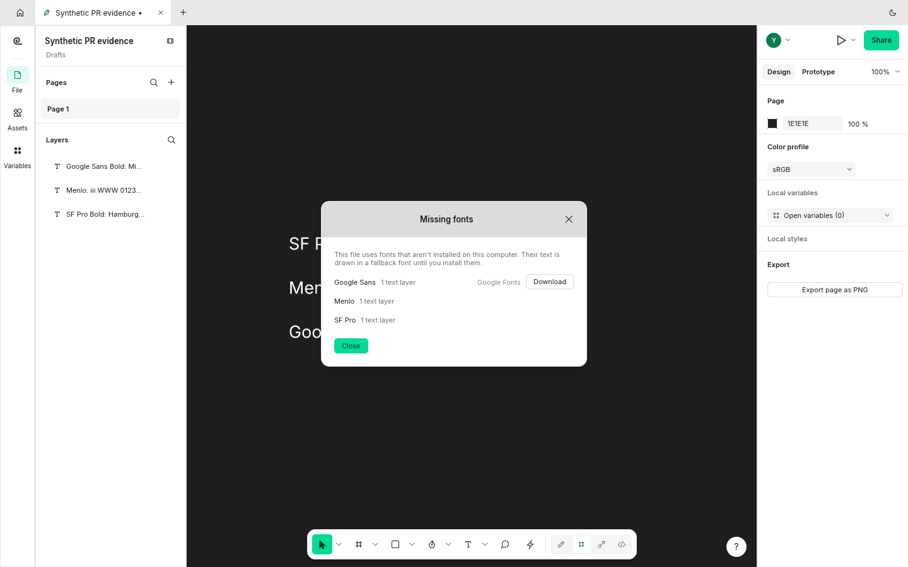
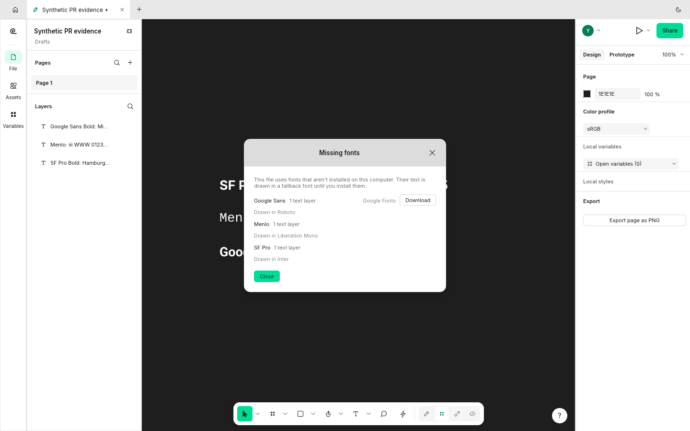
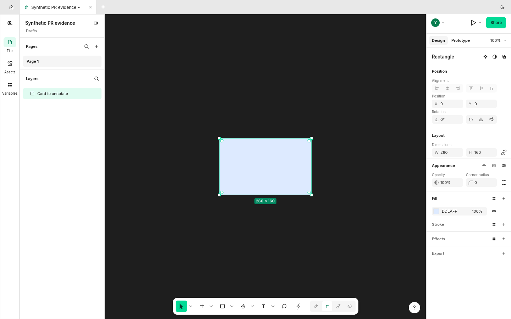
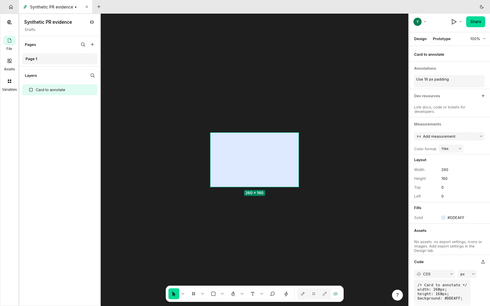
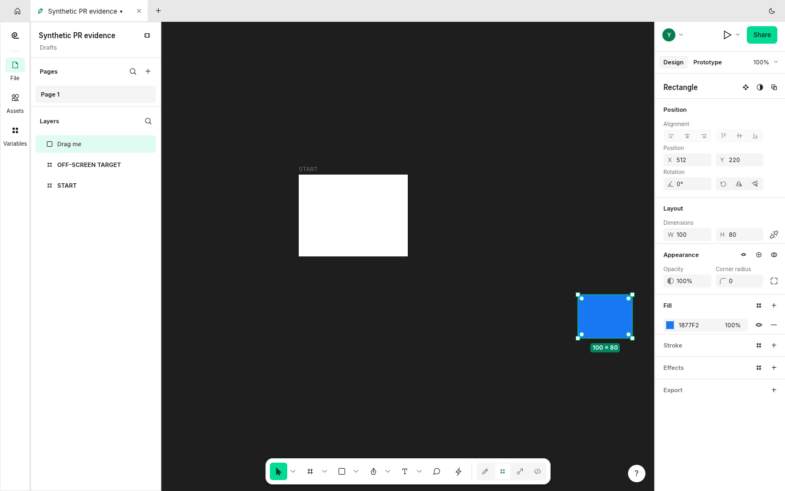
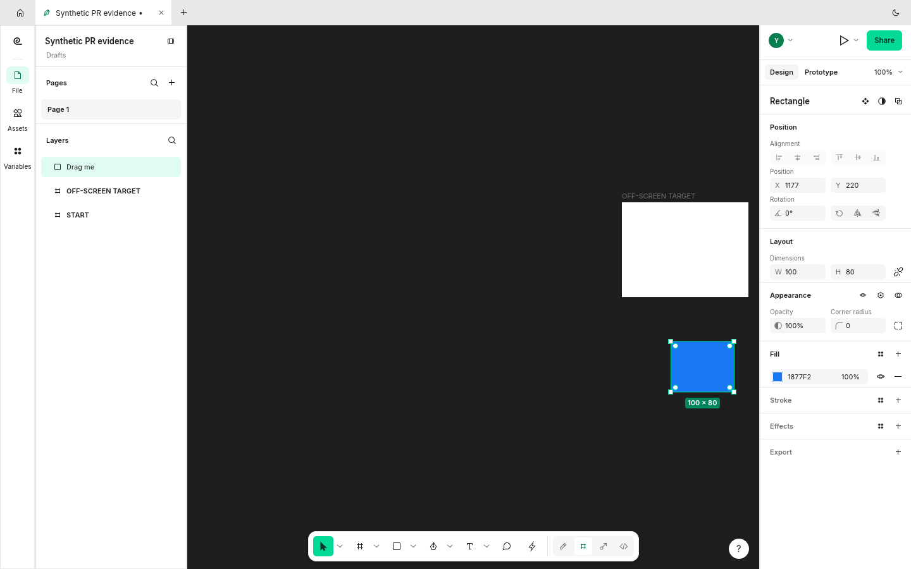
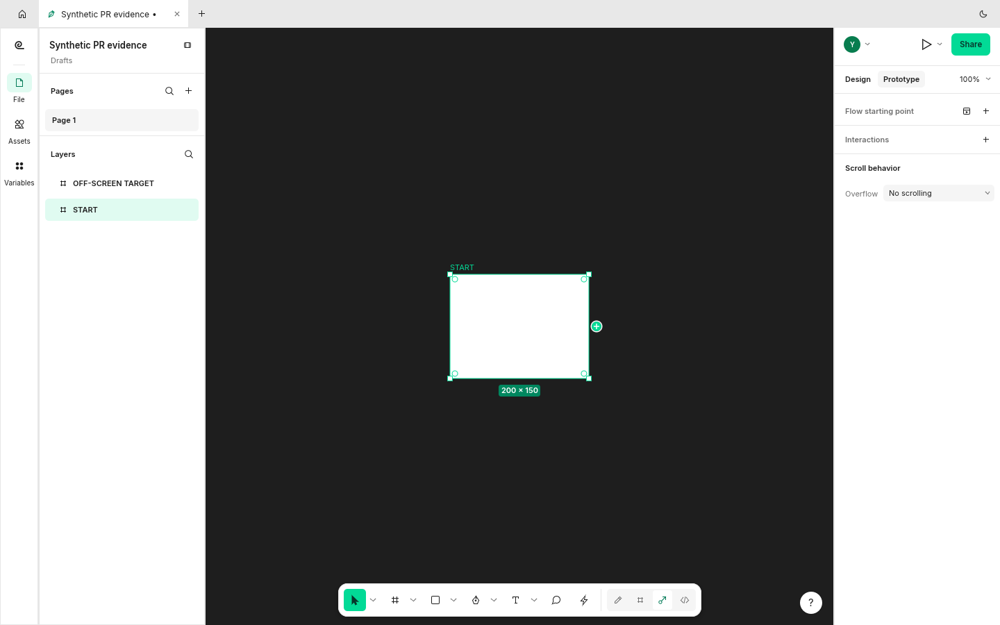
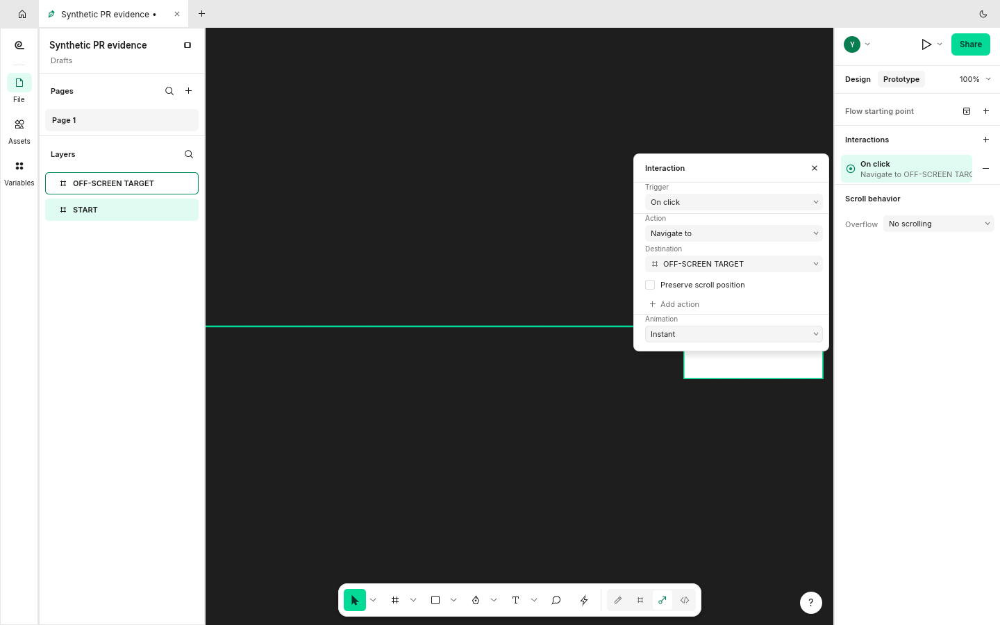

# Branch quality review

Checked 2026-11-06 17:28 CET.

Four proposals are prepared below: three fixes tied to the reported behavior, plus a separately scoped prototype-authoring improvement. They have meaningful tests, actual native before/after evidence, clean merges with checked FigCraft main, passing native builds, strict Clippy and formatting. The prototype proposal explicitly leaves the existing-link click-navigation report open.

Of the 17 development branches, 4 passed this submission-readiness filter, 6 overlap open PRs, 5 need refresh/revalidation, and 2 were held for quality concerns. The remaining uncommitted and helper branches are listed too. A docs conflict alone is not a claim of poor implementation; the useful WordCraft and PhotoCraft branches remain salvage candidates.

## Prepared proposals

| Proposal | Open GitHub form | Full body | URL bytes |
|---|---|---|---:|
| M4: use installed stand-ins for missing UI fonts | [Pre-filled PR](https://github.com/storytold/figcraft/compare/main...StrajnarFilip:figcraft:claude/fix-1237-font-stand-ins?quick_pull=1&title=M4%3A%20use%20installed%20stand-ins%20for%20missing%20UI%20fonts&body=Refs%20%231237.%20Missing%20well-known%20families%20now%20draw%20in%20the%20first%20installed%20close%20substitute%2C%20at%20the%20requested%20style%2C%20while%20remaining%20listed%20as%20missing.%20The%20Missing%20fonts%20dialog%2C%20engine%20response%20and%20CLI%20info%20name%20the%20substitute.%0A%0AThe%20capture%20shows%20SF%20Pro%20using%20Inter%2C%20Menlo%20using%20Liberation%20Mono%2C%20and%20Google%20Sans%20using%20Roboto.%20Actual%20installed%20families%20still%20take%20precedence.%20Custom%20substitution%20overrides%20described%20in%20the%20issue%27s%20prototype%20are%20outside%20this%20change.%0A%0A%23%23%20Screenshots%0A%0ABefore%3A%20generic%20fallback%20and%20no%20substitute%20names.%0A%0A%21%5BBefore%5D%28https%3A%2F%2Fraw.githubusercontent.com%2FStrajnarFilip%2Ffigcraft%2F7d2234f016bf67315da33a8c9fa8d8416a1e646e%2Fscreenshots%2Ffigcraft-1237-before.png%29%0A%0AAfter%3A%20named%20installed%20substitutes%2C%20including%20the%20requested%20bold%20faces.%0A%0A%21%5BAfter%5D%28https%3A%2F%2Fraw.githubusercontent.com%2FStrajnarFilip%2Ffigcraft%2F7d2234f016bf67315da33a8c9fa8d8416a1e646e%2Fscreenshots%2Ffigcraft-1237-after.png%29%0A%0AOriginal%2C%20unedited%201440x900%20FigCraft%20window%20captures%20with%20synthetic%20documents.%20Baseline%20%608eb0b87646c5%60%3B%20after%20%60ad92029ec40e%60.%20%5BCapture%20provenance%5D%28https%3A%2F%2Fraw.githubusercontent.com%2FStrajnarFilip%2Ffigcraft%2F7d2234f016bf67315da33a8c9fa8d8416a1e646e%2Fprovenance.json%29.%0A%0A%23%23%20Validation%0A%0ARust%201.99.1%3A%20native%20build%2C%20strict%20Clippy%20with%20%60-D%20warnings%60%2C%20formatting%2C%20and%20branch%20diff%20whitespace%20checks%20passed.%20The%20full%20native%20UI%20suite%20passed%3A%201016%20tests%2C%200%20failures%2C%201%20ignored%20benchmark.%20Four%20font-database%20regression%20tests%20and%20the%20engine%20missing-family%20test%20passed.%20The%20branch%20merges%20cleanly%20with%20checked%20main%20%600b97f3f1801a%60.%0A%0AFull%20repository%20%60cargo%20xtask%20ci%60%2C%20wasm%2C%20release%20builds%20and%20other%20platforms%20were%20not%20run%20in%20this%20review.%0A) | [Markdown body](https://github.com/StrajnarFilip/figcraft/blob/pr-review-assets-2026-11-06-172508/bodies/figcraft-1237.md) | 2309 |
| M6: activate the Annotation tool with Shift+T | [Pre-filled PR](https://github.com/storytold/figcraft/compare/main...StrajnarFilip:figcraft:claude/fix-1840-annotation-tool?quick_pull=1&title=M6%3A%20activate%20the%20Annotation%20tool%20with%20Shift%2BT&body=Fixes%20%231840.%20Shift%2BT%20enters%20Dev%20Mode%20and%20focuses%20a%20new%20annotation%20for%20the%20selected%20layer.%20With%20no%20layer%20selected%2C%20the%20tool%20waits%20for%20a%20canvas%20click%3B%20Escape%20cancels%20it.%20The%20engine%20exposes%20annotation.tool%20for%20the%20same%20workflow.%0A%0ABoth%20captures%20select%20the%20same%20synthetic%20card%2C%20press%20Shift%2BT%2C%20and%20type%20%22Use%2016%20px%20padding%22.%20The%20baseline%20remains%20in%20Design%3B%20this%20branch%20opens%20and%20fills%20the%20annotation%20draft.%0A%0A%23%23%20Screenshots%0A%0ABefore%3A%20Shift%2BT%20leaves%20the%20Design%20panel%20unchanged.%0A%0A%21%5BBefore%5D%28https%3A%2F%2Fraw.githubusercontent.com%2FStrajnarFilip%2Ffigcraft%2F7d2234f016bf67315da33a8c9fa8d8416a1e646e%2Fscreenshots%2Ffigcraft-1840-before.png%29%0A%0AAfter%3A%20the%20annotation%20draft%20takes%20the%20typed%20text.%0A%0A%21%5BAfter%5D%28https%3A%2F%2Fraw.githubusercontent.com%2FStrajnarFilip%2Ffigcraft%2F7d2234f016bf67315da33a8c9fa8d8416a1e646e%2Fscreenshots%2Ffigcraft-1840-after.png%29%0A%0AOriginal%2C%20unedited%201440x900%20FigCraft%20window%20captures%20with%20synthetic%20documents.%20Baseline%20%608eb0b87646c5%60%3B%20after%20%60460a055d3e71%60.%20%5BCapture%20provenance%5D%28https%3A%2F%2Fraw.githubusercontent.com%2FStrajnarFilip%2Ffigcraft%2F7d2234f016bf67315da33a8c9fa8d8416a1e646e%2Fprovenance.json%29.%0A%0A%23%23%20Validation%0A%0ARust%201.99.1%3A%20native%20build%2C%20strict%20Clippy%20with%20%60-D%20warnings%60%2C%20formatting%2C%20and%20branch%20diff%20whitespace%20checks%20passed.%20The%20full%20native%20UI%20suite%20passed%3A%201019%20tests%2C%200%20failures%2C%201%20ignored%20benchmark.%20Twelve%20annotation%20engine%20tests%20and%20three%20focused%20annotation-tool%20UI%20tests%20passed%2C%20including%20cancel%20and%20click-to-select.%20The%20branch%20merges%20cleanly%20with%20checked%20main%20%600b97f3f1801a%60.%0A%0AFull%20repository%20%60cargo%20xtask%20ci%60%2C%20wasm%2C%20release%20builds%20and%20other%20platforms%20were%20not%20run%20in%20this%20review.%0A) | [Markdown body](https://github.com/StrajnarFilip/figcraft/blob/pr-review-assets-2026-11-06-172508/bodies/figcraft-1840.md) | 2275 |
| M1: keep canvas drags moving over panels and pan at the edges | [Pre-filled PR](https://github.com/storytold/figcraft/compare/main...StrajnarFilip:figcraft:claude/fix-2023-drag-over-panels?quick_pull=1&title=M1%3A%20keep%20canvas%20drags%20moving%20over%20panels%20and%20pan%20at%20the%20edges&body=Addresses%20the%20dragging%20part%20of%20%232023.%20A%20drag%20started%20on%20the%20canvas%20keeps%20receiving%20movement%20over%20the%20side%20panels.%20Holding%20it%20near%20or%20beyond%20an%20edge%20pans%20the%20view%3B%20the%20Hand%20tool%20is%20excluded%2C%20and%20a%20stationary%20press%20does%20not%20start%20panning.%0A%0AThe%20capture%20moves%20the%20same%20blue%20rectangle%20toward%20the%20right%20edge.%20Before%2C%20the%20view%20remains%20at%20x%3D200%20and%20the%20target%20frame%20stays%20outside%20the%20view.%20After%2C%20the%20view%20reaches%20about%20x%3D865%20and%20the%20target%20becomes%20visible.%20Releasing%20still%20ends%20one%20undoable%20move.%20The%20separate%20alignment%20report%20remains%20open.%0A%0A%23%23%20Screenshots%0A%0ABefore%3A%20the%20view%20stays%20fixed%3B%20the%20blue%20rectangle%20stops%20at%20the%20original%20viewport.%0A%0A%21%5BBefore%5D%28https%3A%2F%2Fraw.githubusercontent.com%2FStrajnarFilip%2Ffigcraft%2F7d2234f016bf67315da33a8c9fa8d8416a1e646e%2Fscreenshots%2Ffigcraft-2023-before.png%29%0A%0AAfter%3A%20the%20drag%20continues%20as%20the%20view%20reveals%20the%20target%20frame.%0A%0A%21%5BAfter%5D%28https%3A%2F%2Fraw.githubusercontent.com%2FStrajnarFilip%2Ffigcraft%2F7d2234f016bf67315da33a8c9fa8d8416a1e646e%2Fscreenshots%2Ffigcraft-2023-after.png%29%0A%0AOriginal%2C%20unedited%201440x900%20FigCraft%20window%20captures%20with%20synthetic%20documents.%20Baseline%20%608eb0b87646c5%60%3B%20after%20%60201d4b432e8f%60.%20%5BCapture%20provenance%5D%28https%3A%2F%2Fraw.githubusercontent.com%2FStrajnarFilip%2Ffigcraft%2F7d2234f016bf67315da33a8c9fa8d8416a1e646e%2Fprovenance.json%29.%0A%0A%23%23%20Validation%0A%0ARust%201.99.1%3A%20native%20build%2C%20strict%20Clippy%20with%20%60-D%20warnings%60%2C%20formatting%2C%20and%20branch%20diff%20whitespace%20checks%20passed.%20The%20full%20native%20UI%20suite%20passed%3A%201020%20tests%2C%200%20failures%2C%201%20ignored%20benchmark.%20Three%20focused%20UI%20regressions%20cover%20dragging%20over%20a%20panel%2C%20holding%20at%20the%20edge%2C%20and%20a%20stationary%20press%3B%20the%20full%20UI%20suite%20also%20includes%20the%20edge-pan%20boundary%20test.%20The%20branch%20merges%20cleanly%20with%20checked%20main%20%600b97f3f1801a%60.%0A%0AFull%20repository%20%60cargo%20xtask%20ci%60%2C%20wasm%2C%20release%20builds%20and%20other%20platforms%20were%20not%20run%20in%20this%20review.%0A) | [Markdown body](https://github.com/StrajnarFilip/figcraft/blob/pr-review-assets-2026-11-06-172508/bodies/figcraft-2023.md) | 2611 |
| M5: pan the editor while authoring prototype connections | [Pre-filled PR](https://github.com/storytold/figcraft/compare/main...StrajnarFilip:figcraft:claude/fix-2015-proto-drag-autopan?quick_pull=1&title=M5%3A%20pan%20the%20editor%20while%20authoring%20prototype%20connections&body=A%20connection%20dragged%20from%20a%20layer%27s%20plus%20handle%20now%20pans%20the%20editor%20near%20the%20canvas%20edge%2C%20so%20a%20frame%20outside%20the%20view%20can%20be%20reached%20and%20connected%20without%20abandoning%20the%20drag.%20The%20connection%20remains%20anchored%20to%20its%20source%20as%20the%20view%20moves.%20A%20press%20without%20movement%20does%20not%20pan.%0A%0AScope%3A%20authoring%20connection%20drags.%20Clicking%20existing%20links%2C%20as%20described%20in%20%232015%2C%20remains%20open%3B%20this%20PR%20should%20not%20close%20that%20issue.%0A%0AThe%20same%20synthetic%20scene%20has%20START%20at%20x%3D0%20and%20a%20target%20at%20x%3D1100.%20Before%2C%20the%20view%20stays%20at%20x%3D100%20and%20no%20connection%20is%20created.%20After%2C%20the%20view%20reaches%20about%20x%3D863%20and%20the%20recorded%20interaction%20navigates%20from%20START%20to%20the%20target.%0A%0A%23%23%20Screenshots%0A%0ABefore%3A%20holding%20the%20connection%20at%20the%20edge%20cannot%20reach%20the%20target.%0A%0A%21%5BBefore%5D%28https%3A%2F%2Fraw.githubusercontent.com%2FStrajnarFilip%2Ffigcraft%2F7d2234f016bf67315da33a8c9fa8d8416a1e646e%2Fscreenshots%2Ffigcraft-2015-before.png%29%0A%0AAfter%3A%20the%20target%20is%20reachable%20and%20a%20real%20navigation%20interaction%20is%20created.%0A%0A%21%5BAfter%5D%28https%3A%2F%2Fraw.githubusercontent.com%2FStrajnarFilip%2Ffigcraft%2F7d2234f016bf67315da33a8c9fa8d8416a1e646e%2Fscreenshots%2Ffigcraft-2015-after.png%29%0A%0AOriginal%2C%20unedited%201440x900%20FigCraft%20window%20captures%20with%20synthetic%20documents.%20Baseline%20%608eb0b87646c5%60%3B%20after%20%6077c53f447ce9%60.%20%5BCapture%20provenance%5D%28https%3A%2F%2Fraw.githubusercontent.com%2FStrajnarFilip%2Ffigcraft%2F7d2234f016bf67315da33a8c9fa8d8416a1e646e%2Fprovenance.json%29.%0A%0A%23%23%20Validation%0A%0ARust%201.99.1%3A%20native%20build%2C%20strict%20Clippy%20with%20%60-D%20warnings%60%2C%20formatting%2C%20and%20branch%20diff%20whitespace%20checks%20passed.%20The%20full%20native%20UI%20suite%20passed%3A%201019%20tests%2C%200%20failures%2C%201%20ignored%20benchmark.%20Four%20prototype-canvas%20tests%20passed%2C%20including%20reaching%20a%20frame%20outside%20the%20view%20and%20keeping%20a%20press%20from%20panning.%20The%20branch%20merges%20cleanly%20with%20checked%20main%20%600b97f3f1801a%60.%0A%0AFull%20repository%20%60cargo%20xtask%20ci%60%2C%20wasm%2C%20release%20builds%20and%20other%20platforms%20were%20not%20run%20in%20this%20review.%0A) | [Markdown body](https://github.com/StrajnarFilip/figcraft/blob/pr-review-assets-2026-11-06-172508/bodies/figcraft-2015.md) | 2686 |

[Optional separate authoring-drag issue](https://github.com/storytold/figcraft/issues/new?title=Prototype%20connection%20drags%20cannot%20reach%20frames%20outside%20the%20view&body=When%20authoring%20a%20prototype%20connection%2C%20holding%20its%20plus-handle%20drag%20near%20the%20canvas%20edge%20does%20not%20pan%20the%20editor.%20A%20frame%20outside%20the%20view%20cannot%20be%20reached%20without%20abandoning%20the%20drag.%0A%0AReproduction%20on%20baseline%20%608eb0b87646c5%60%3A%20create%20two%20200x150%20frames%20at%20x%3D0%20and%20x%3D1100%2C%20select%20the%20first%2C%20open%20Prototype%2C%20drag%20its%20connection%20handle%20to%20the%20right%20edge%20and%20hold.%20The%20view%20stays%20at%20x%3D100%20and%20no%20connection%20to%20the%20target%20is%20created.%0A%0AExpected%3A%20pan%20during%20the%20authoring%20drag%2C%20keep%20the%20source%20anchor%20correct%2C%20and%20allow%20a%20drop%20on%20the%20target.%20A%20reviewed%20local%20implementation%20does%20this%20and%20creates%20a%20navigation%20interaction.%0A%0A%21%5BBefore%5D%28https%3A%2F%2Fraw.githubusercontent.com%2FStrajnarFilip%2Ffigcraft%2F7d2234f016bf67315da33a8c9fa8d8416a1e646e%2Fscreenshots%2Ffigcraft-2015-before.png%29%0A%0A%21%5BAfter%5D%28https%3A%2F%2Fraw.githubusercontent.com%2FStrajnarFilip%2Ffigcraft%2F7d2234f016bf67315da33a8c9fa8d8416a1e646e%2Fscreenshots%2Ffigcraft-2015-after.png%29%0A%0ARelated%20%232015%20describes%20clicking%20existing%20links.%20This%20report%20isolates%20the%20separate%20authoring-drag%20workflow.%20Original%20synthetic%20FigCraft%20captures%3B%20%5Bprovenance%5D%28https%3A%2F%2Fraw.githubusercontent.com%2FStrajnarFilip%2Ffigcraft%2F7d2234f016bf67315da33a8c9fa8d8416a1e646e%2Fprovenance.json%29.%0A) (1676 bytes). Its [full body](https://github.com/StrajnarFilip/figcraft/blob/pr-review-assets-2026-11-06-172508/bodies/prototype-authoring-issue.md) is also saved.

All encoded links are below 7,000 bytes and carry the actual title and full body. No body placeholder is needed. Every referenced screenshot was uploaded first and is pinned to its GitHub asset commit. The body files are supplied independently for editing or copying. These links populate GitHub forms; submitting remains with you.

[All full URLs as plain text](https://github.com/StrajnarFilip/figcraft/blob/pr-review-assets-2026-11-06-172508/PR-URLS.txt) · [URLs and metadata as JSON](https://github.com/StrajnarFilip/figcraft/blob/pr-review-assets-2026-11-06-172508/PR-URLS.json) · [Validation details](https://github.com/StrajnarFilip/figcraft/blob/pr-review-assets-2026-11-06-172508/validation.json) · [Screenshot provenance](https://raw.githubusercontent.com/StrajnarFilip/figcraft/7d2234f016bf67315da33a8c9fa8d8416a1e646e/provenance.json)

## Before and after

### M4: use installed stand-ins for missing UI fonts

Before: generic fallback and no substitute names. After: named installed substitutes, including the requested bold faces.

| Before | After |
|---|---|
|  |  |

### M6: activate the Annotation tool with Shift+T

Before: Shift+T leaves the Design panel unchanged. After: the annotation draft takes the typed text.

| Before | After |
|---|---|
|  |  |

### M1: keep canvas drags moving over panels and pan at the edges

Before: the view stays fixed; the blue rectangle stops at the original viewport. After: the drag continues as the view reveals the target frame.

| Before | After |
|---|---|
|  |  |

### M5: pan the editor while authoring prototype connections

Before: holding the connection at the edge cannot reach the target. After: the target is reachable and a real navigation interaction is created.

| Before | After |
|---|---|
|  |  |

## Every reviewed branch

| Repository | Branch | Decision | Reason |
|---|---|---|---|
| figcraft | `claude/fix-1237-font-stand-ins` | Prepared | Installed stand-ins and diagnostics; native capture and focused regression checks. Custom substitute overrides from the issue prototype are outside this branch. |
| figcraft | `claude/fix-1840-annotation-tool` | Prepared | Narrow shortcut/tool implementation with engine and UI tests. |
| figcraft | `claude/fix-1875-vector-clipboard` | Hold: quality concern | Confirmed regression: copying a closed vector region with an image fill retains the image reference but does not copy image bytes. Added review regression fails. |
| figcraft | `claude/fix-2002-variables-multiselect` | Hold: overlapping PR | Open PR [#2025](https://github.com/storytold/figcraft/pull/2025) already implements the same selection workflow; this branch is also local-only and has a docs conflict. |
| figcraft | `claude/fix-2015-proto-drag-autopan` | Prepared: separate scope | Useful, bounded authoring-drag improvement with end-to-end UI tests. Issue [#2015](https://github.com/storytold/figcraft/issues/2015) describes clicking links, so the proposed PR must explicitly keep click navigation open and describe authoring drags. |
| figcraft | `claude/fix-2023-drag-over-panels` | Prepared | Directly addresses drag continuity and edge panning, with undo and stationary-press tests. Alignment is outside scope. |
| figcraft | `codex/vector-drawable-integration` | Hold: refresh and revalidate | Reintroduces the already merged base export feature and conflicts across 28 paths. Extract only the remaining validation/precision/name fixes into a new narrow patch. |
| figcraft | `codex/vector-drawable-writer` | Hold: refresh and revalidate | Shares the writer commit with integration; re-adds existing crate files and conflicts across 11 paths. Do not submit this branch as-is. |
| wordcraft | `fix/3573-nav-pane-delete-heading` | Hold: refresh and revalidate | Strong functional candidate with meaningful deletion, tracking, formatting and UI tests; conflicts in ROADMAP.md and docs/ui-parity.md. Refresh and revalidate on current main before calling it ready. |
| wordcraft | `fix/3695-confine-control-channel` | Hold: overlapping PR | Open PR [#5140](https://github.com/storytold/wordcraft/pull/5140) adds the same confinement controls as part of CLI/control options. Prefer reviewing that PR and identifying any real gaps instead of a second competing implementation. |
| wordcraft | `fix/4870-greeting-local-time` | Hold: overlapping PR | Open PR [#4933](https://github.com/storytold/wordcraft/pull/4933) fixes the same local-hour greeting; this branch also conflicts in backstage.rs. |
| wordcraft | `fix/4911-page-number-start-zero` | Hold: overlapping PR | Open PR [#4927](https://github.com/storytold/wordcraft/pull/4927) fixes the same behavior from another fork. |
| wordcraft | `fix/5361-continue-numbering` | Hold: overlapping PR | Open PR [#5245](https://github.com/storytold/wordcraft/pull/5245) covers continuation across unnumbered paragraphs and a broader numbering workflow. |
| wordcraft | `fix/5393-embedded-object-warning` | Hold: refresh and revalidate | Useful CLI/API warning alternative, not embedded-document rendering. A ROADMAP.md conflict remains. Refresh and revalidate; do not claim this fixes all of [#5393](https://github.com/storytold/wordcraft/issues/5393) or warns through every GUI export path. |
| wordcraft | `fix/5740-save-prefs-on-change` | Hold: quality concern | PrefsSaver treats a failed write as the new saved bytes and will not retry until another preference change; transient failures can leave the promised early persistence absent. PR [#5766](https://github.com/storytold/wordcraft/pull/5766) independently addresses the reported spelling-setting synchronization. Needs recovery coverage and narrower claims. |
| pdfcraft | `fix/paragraph-drag-5212` | Hold: overlapping PR | Open PR [#5450](https://github.com/storytold/pdfcraft/pull/5450) already implements pixel-based paragraph drag previews. This branch also has code and attribution conflicts. |
| photocraft | `codex/warn-8839-color-lookup-export` | Hold: refresh and revalidate | Potentially useful warning-only mitigation, with existing IO tests and captures, but conflicts in attribution, contributors and parity/gaps docs after substantial upstream changes. Refresh and revalidate; native Photoshop encoding remains unsolved. |
| figcraft | `claude/lan-share-read-only` | Unfinished | Uncommitted work; no unique committed changes yet. |
| pdfcraft | `feat/slovenian-translations` | Unfinished | Uncommitted translation and progress changes; no unique committed changes yet. |
| figcraft | `claude/medium-issues` | Already covered | Already split into merged PRs [#1480](https://github.com/storytold/figcraft/pull/1480), [#1481](https://github.com/storytold/figcraft/pull/1481) and [#1482](https://github.com/storytold/figcraft/pull/1482). |
| figcraft | `codex/vector-drawable-review` | Already covered | Already merged through [#840](https://github.com/storytold/figcraft/pull/840). |
| wordcraft | `pr-assets/4848-corporate-author` | Evidence only | Screenshots for existing PR [#4898](https://github.com/storytold/wordcraft/pull/4898); no new source PR needed. |
| wordcraft | `pr-assets/4850-narrow-window` | Evidence only | Screenshots for existing PR [#4897](https://github.com/storytold/wordcraft/pull/4897); no new source PR needed. |
| wordcraft | `pr-assets/4857-table-row-properties` | Evidence only | Screenshots for existing PR [#4896](https://github.com/storytold/wordcraft/pull/4896); no new source PR needed. |

## Quality evidence and limits

The vector clipboard exclusion is confirmed by a new review regression using a valid synthetic PNG in a region fill. Copy retains the region but omits its referenced image payload. The regression fails on the reviewed branch. The [reproduction test](https://github.com/StrajnarFilip/figcraft/blob/pr-review-assets-2026-11-06-172508/clipboard-region-image-regression.rs) is saved for repair; it was not added to the source branch.

Preferences persistence was held because the write callback cannot report success and the saver records the new bytes after every attempt. A transient write failure is therefore not retried while those settings remain unchanged. This is distinct from the spelling-preference synchronization fix in the existing PR.

Native validation used Rust 1.99.1. The initial attempt with the default Rust 1.95 stopped in unchanged pathops code; the installed current stable toolchain builds the branches. Full repository CI, wasm, release and cross-platform checks were not run. The only ignored test in each full UI run is the existing performance benchmark.

No source branches were changed or pushed, and no PRs or issues were submitted. Only the isolated artifact branch was published.
