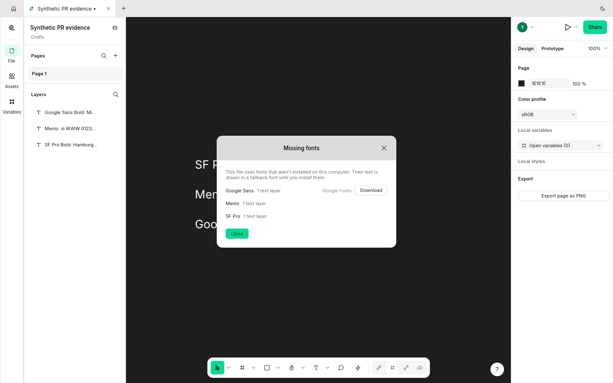
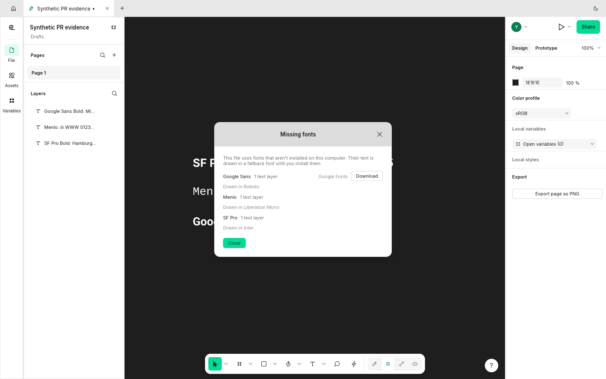

Refs #1237. Missing well-known families now draw in the first installed close substitute, at the requested style, while remaining listed as missing. The Missing fonts dialog, engine response and CLI info name the substitute.

The capture shows SF Pro using Inter, Menlo using Liberation Mono, and Google Sans using Roboto. Actual installed families still take precedence. Custom substitution overrides described in the issue's prototype are outside this change.

## Screenshots

Before: generic fallback and no substitute names.

After: named installed substitutes, including the requested bold faces.

Original, unedited 1440x900 FigCraft window captures with synthetic documents. Baseline `8eb0b87646c5`; after `ad92029ec40e`. [Capture provenance](https://raw.githubusercontent.com/StrajnarFilip/figcraft/7d2234f016bf67315da33a8c9fa8d8416a1e646e/provenance.json).

## Validation

Rust 1.99.1: native build, strict Clippy with `-D warnings`, formatting, and branch diff whitespace checks passed. The full native UI suite passed: 1016 tests, 0 failures, 1 ignored benchmark. Four font-database regression tests and the engine missing-family test passed. The branch merges cleanly with checked main `0b97f3f1801a`.

Full repository `cargo xtask ci`, wasm, release builds and other platforms were not run in this review.
