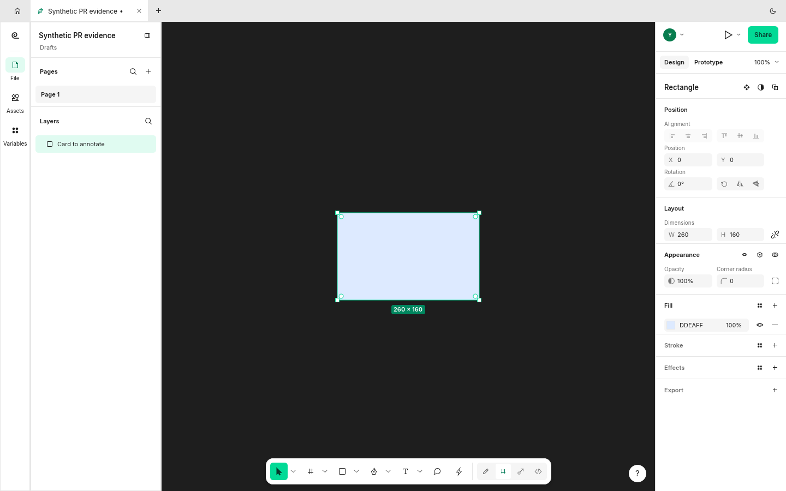
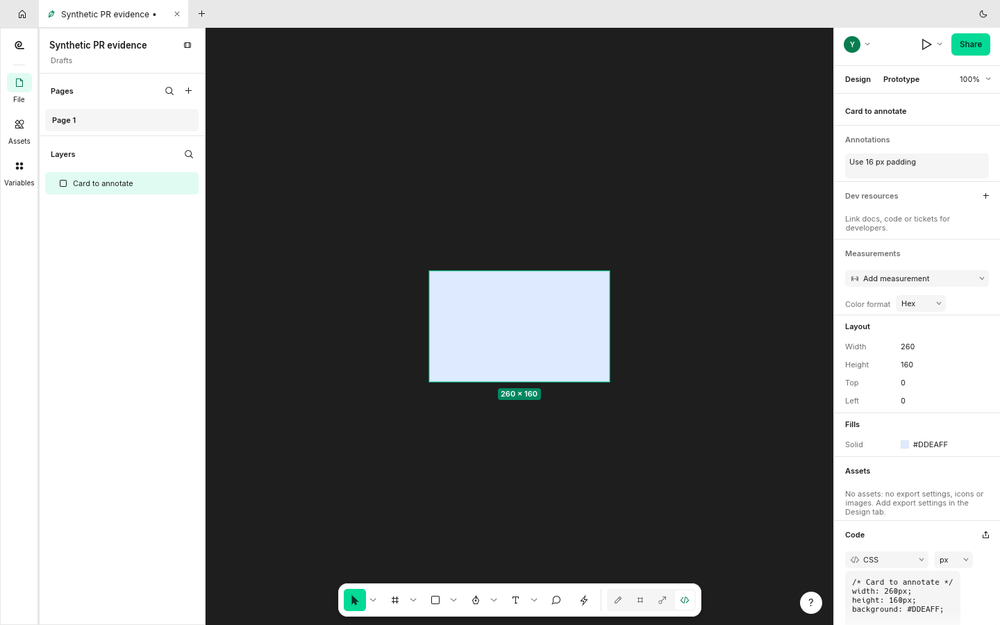

Fixes #1840. Shift+T enters Dev Mode and focuses a new annotation for the selected layer. With no layer selected, the tool waits for a canvas click; Escape cancels it. The engine exposes annotation.tool for the same workflow.

Both captures select the same synthetic card, press Shift+T, and type "Use 16 px padding". The baseline remains in Design; this branch opens and fills the annotation draft.

## Screenshots

Before: Shift+T leaves the Design panel unchanged.

After: the annotation draft takes the typed text.

Original, unedited 1440x900 FigCraft window captures with synthetic documents. Baseline `8eb0b87646c5`; after `460a055d3e71`. [Capture provenance](https://raw.githubusercontent.com/StrajnarFilip/figcraft/7d2234f016bf67315da33a8c9fa8d8416a1e646e/provenance.json).

## Validation

Rust 1.99.1: native build, strict Clippy with `-D warnings`, formatting, and branch diff whitespace checks passed. The full native UI suite passed: 1019 tests, 0 failures, 1 ignored benchmark. Twelve annotation engine tests and three focused annotation-tool UI tests passed, including cancel and click-to-select. The branch merges cleanly with checked main `0b97f3f1801a`.

Full repository `cargo xtask ci`, wasm, release builds and other platforms were not run in this review.
