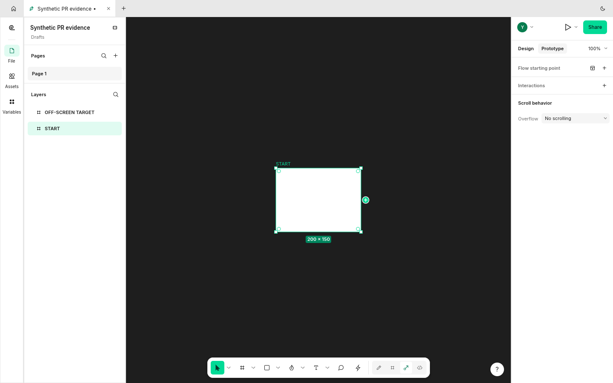
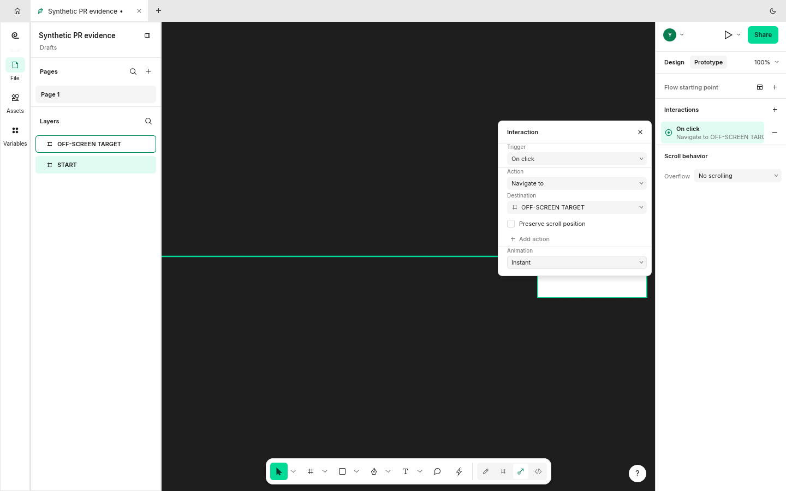

A connection dragged from a layer's plus handle now pans the editor near the canvas edge, so a frame outside the view can be reached and connected without abandoning the drag. The connection remains anchored to its source as the view moves. A press without movement does not pan.

Scope: authoring connection drags. Clicking existing links, as described in #2015, remains open; this PR should not close that issue.

The same synthetic scene has START at x=0 and a target at x=1100. Before, the view stays at x=100 and no connection is created. After, the view reaches about x=863 and the recorded interaction navigates from START to the target.

## Screenshots

Before: holding the connection at the edge cannot reach the target.

After: the target is reachable and a real navigation interaction is created.

Original, unedited 1440x900 FigCraft window captures with synthetic documents. Baseline `8eb0b87646c5`; after `77c53f447ce9`. [Capture provenance](https://raw.githubusercontent.com/StrajnarFilip/figcraft/7d2234f016bf67315da33a8c9fa8d8416a1e646e/provenance.json).

## Validation

Rust 1.99.1: native build, strict Clippy with `-D warnings`, formatting, and branch diff whitespace checks passed. The full native UI suite passed: 1019 tests, 0 failures, 1 ignored benchmark. Four prototype-canvas tests passed, including reaching a frame outside the view and keeping a press from panning. The branch merges cleanly with checked main `0b97f3f1801a`.

Full repository `cargo xtask ci`, wasm, release builds and other platforms were not run in this review.
