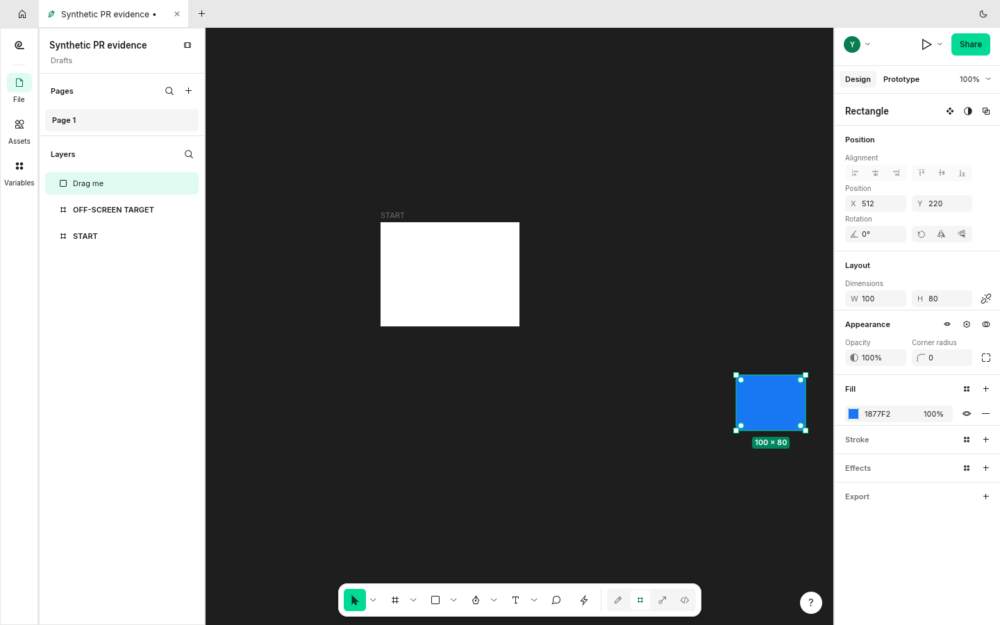
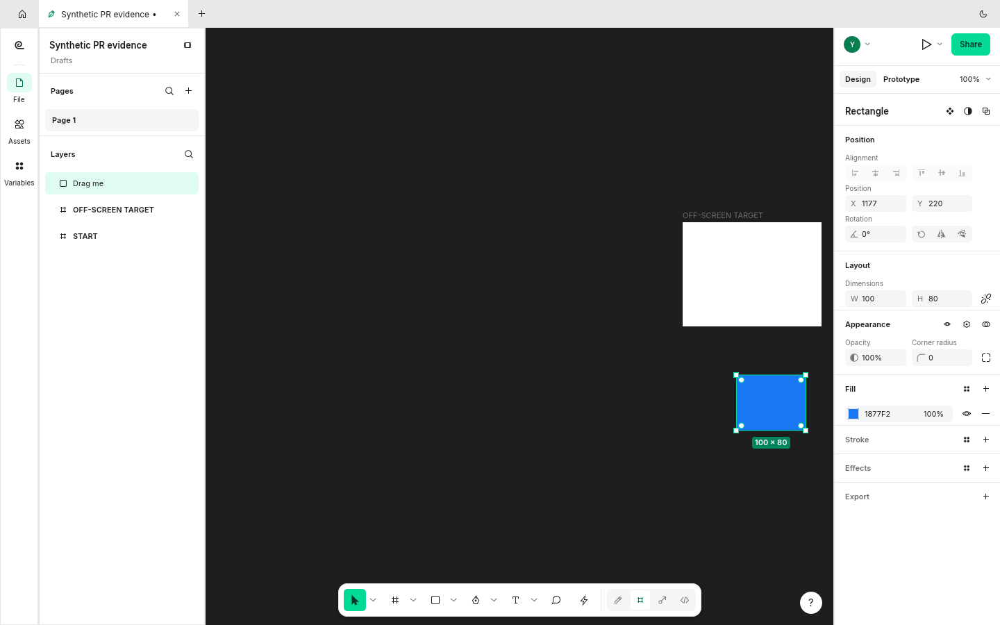

Addresses the dragging part of #2023. A drag started on the canvas keeps receiving movement over the side panels. Holding it near or beyond an edge pans the view; the Hand tool is excluded, and a stationary press does not start panning.

The capture moves the same blue rectangle toward the right edge. Before, the view remains at x=200 and the target frame stays outside the view. After, the view reaches about x=865 and the target becomes visible. Releasing still ends one undoable move. The separate alignment report remains open.

## Screenshots

Before: the view stays fixed; the blue rectangle stops at the original viewport.

After: the drag continues as the view reveals the target frame.

Original, unedited 1440x900 FigCraft window captures with synthetic documents. Baseline `8eb0b87646c5`; after `201d4b432e8f`. [Capture provenance](https://raw.githubusercontent.com/StrajnarFilip/figcraft/7d2234f016bf67315da33a8c9fa8d8416a1e646e/provenance.json).

## Validation

Rust 1.99.1: native build, strict Clippy with `-D warnings`, formatting, and branch diff whitespace checks passed. The full native UI suite passed: 1020 tests, 0 failures, 1 ignored benchmark. Three focused UI regressions cover dragging over a panel, holding at the edge, and a stationary press; the full UI suite also includes the edge-pan boundary test. The branch merges cleanly with checked main `0b97f3f1801a`.

Full repository `cargo xtask ci`, wasm, release builds and other platforms were not run in this review.
