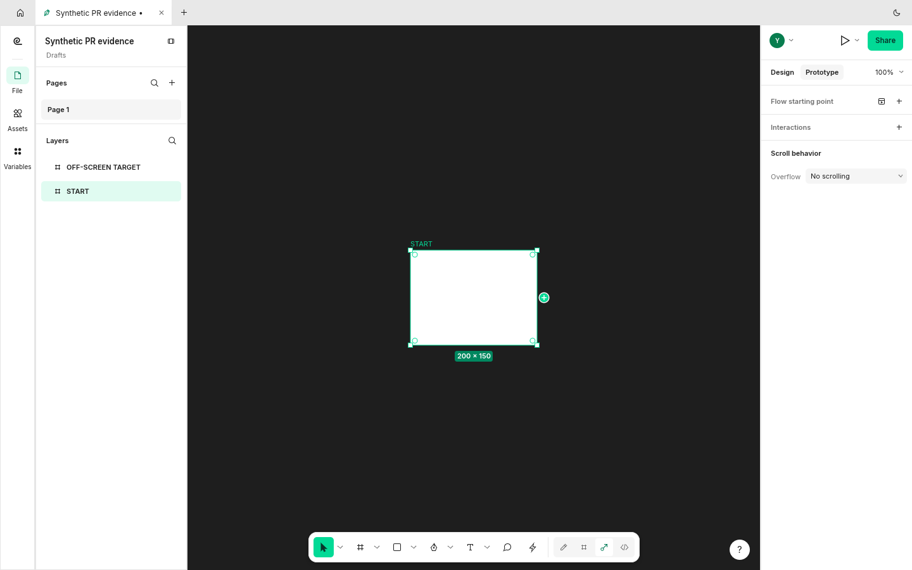
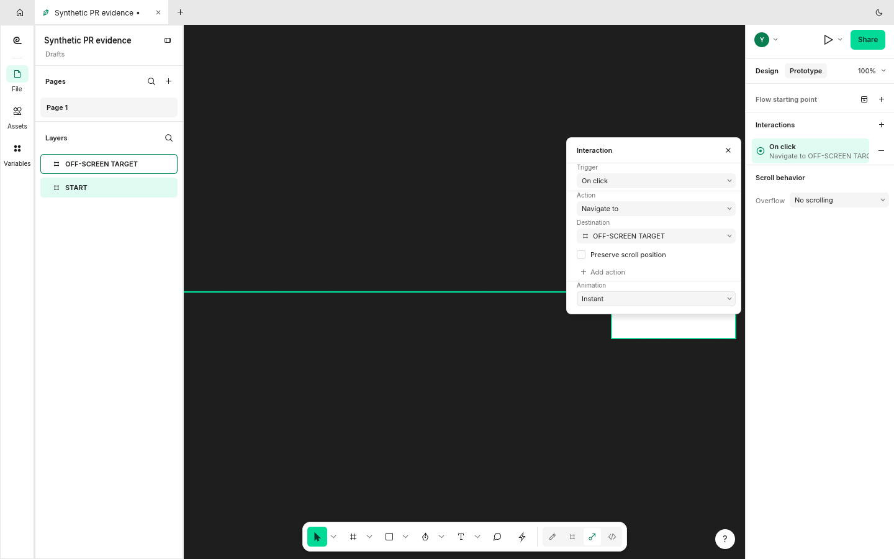

When authoring a prototype connection, holding its plus-handle drag near the canvas edge does not pan the editor. A frame outside the view cannot be reached without abandoning the drag.

Reproduction on baseline `8eb0b87646c5`: create two 200x150 frames at x=0 and x=1100, select the first, open Prototype, drag its connection handle to the right edge and hold. The view stays at x=100 and no connection to the target is created.

Expected: pan during the authoring drag, keep the source anchor correct, and allow a drop on the target. A reviewed local implementation does this and creates a navigation interaction.

Related #2015 describes clicking existing links. This report isolates the separate authoring-drag workflow. Original synthetic FigCraft captures; [provenance](https://raw.githubusercontent.com/StrajnarFilip/figcraft/7d2234f016bf67315da33a8c9fa8d8416a1e646e/provenance.json).
